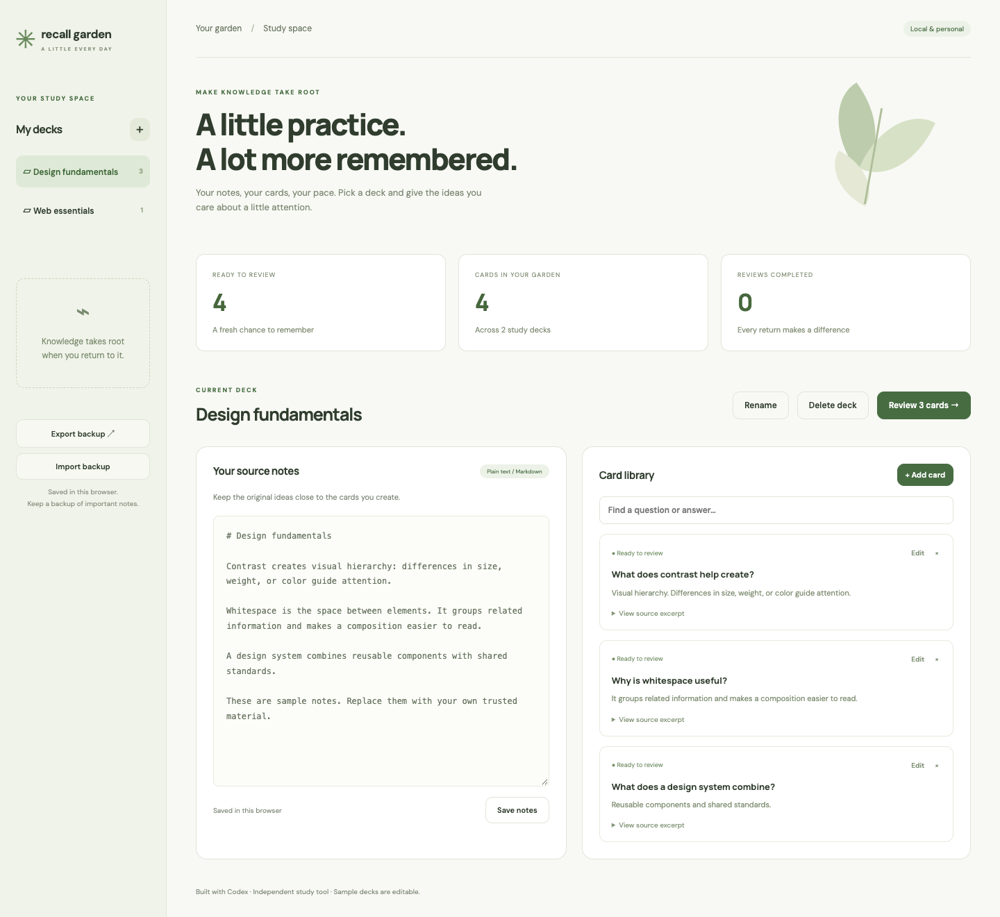

# Recall Garden

[Open live app](https://mohdriyaazpersonal.github.io/recall-garden/)



A quiet study workspace with editable decks, source notes, manual flashcard creation and editing, searchable card libraries, source excerpts, and spaced review scheduling. Two sample decks make the app useful immediately.

## Run and verify

Requires Node.js 22+. No third-party dependencies.

```sh
npm start
npm test
npm run build
```

Open the URL printed by the server. `dist/` can be hosted as a static site. Tests cover review intervals, due-date boundaries and backup validation.

## Use

1. Create a deck, paste plain text or Markdown notes, and save.
2. Write a question and answer. Add an excerpt from your trusted source so you can verify the answer later.
3. Review due cards, reveal each answer, and choose Again, Hard, Good or Easy.
4. Export a JSON backup before clearing browser data. Import validates the entire file before asking to replace current decks.

Again schedules 10 minutes later. Other grades use whole-day intervals: Hard at least 1 day and 1.2× the prior interval, Good at least 1 day and 2.5×, Easy at least 4 days and 3.5×. This is a simple transparent practice schedule, not a validated learning-science model.

## Storage and limitations

Data stays in localStorage for this browser/origin. There is no login, cloud sync, encryption, or AI generation. Markdown is kept as editable plain text, not executed as HTML. Anyone using this browser profile can access its notes. Use JSON backups to move devices; browser storage is not a permanent backup. Google Fonts falls back to system fonts offline.

Built with Codex, inspired by [Build a Living Study Guide](https://app.joinhandshake.com/learn/build-a-living-study-guide-d876ca77). The original mission specifies Replit AI generation, a source-linked approval queue, persistence, private login and publishing. This independent manual study tool does not perform those provider-specific steps and has not been submitted to Handshake.
